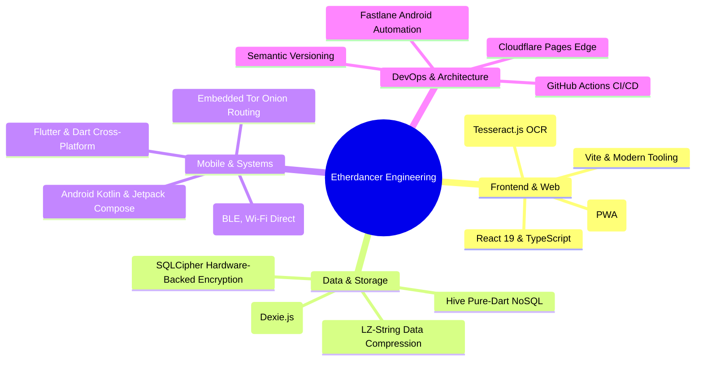

# Awesome Etherdancer Applications 🚀

A curated collection of production-grade Progressive Web Apps (PWAs), native Android systems, and cross-platform Flutter applications built by **Etherdancer**. 

Every featured project is engineered around **local-first architecture**, **user privacy**, and **clean code standards**—with live web deployments and complete source code available below.

---

## 🌟 Featured Showcase Projects

| Project | Platform | Stack | Links |
|---|---|---|---|
| **OffGridDoc** — on-device OCR & PII redaction | Web (PWA) | React 19 · TypeScript · Tesseract.js · PDF.js | [Live](https://offgriddoc.pages.dev/) · [Code](https://github.com/Etherdancer/offgriddoc) |
| **Activity Log** — local-first habit & time tracker | Web (PWA) | React 19 · TypeScript · Dexie (IndexedDB) | [Live](https://activity-log-pwa.pages.dev/) · [Code](https://github.com/Etherdancer/activity-log-pwa) |
| **Clear Space** — decentralized P2P mesh & social platform | Android | Kotlin · Compose · BLE / Wi-Fi Direct · Tor | [Code](https://github.com/Etherdancer/ClearSpace) |
| **Window Garden Idle** — cozy botanical simulation | Android · Web | Flutter · Riverpod · Hive | [Code](https://github.com/Etherdancer/window-garden-idle) |

### 1. [OffGridDoc](https://github.com/Etherdancer/offgriddoc) — On-Device OCR & PII Redaction PWA

- **Tech Stack**: React 19, TypeScript 5, Vite 8, Tesseract.js (WebAssembly), PDF.js, jsPDF, Piexifjs, PWA.
- **Core Capability**: A 100% offline document sanitizer that runs optical character recognition directly inside isolated browser Web Workers.
- **Key Engineering**:
  - Automatically identifies sensitive PII (names, addresses, national IDs, birthplaces) via regex heuristics.
  - Multi-page interactive PDF canvas viewer with permanent blackout and blur redaction masks.
  - Strips hidden EXIF and GPS camera metadata without sending a single byte over the network.

---

### 2. [Activity Log](https://github.com/Etherdancer/activity-log-pwa) — Local-First Habit & Time Tracker

- **Tech Stack**: React 19, TypeScript 5, Vite 8, Dexie.js (IndexedDB), `lz-string`, `react-i18next`, GitHub Actions CI/CD.
- **Core Capability**: A privacy-first daily routine and habit audit tool designed on local-first database principles.
- **Key Engineering**:
  - Direct client persistence using IndexedDB with ACID-compliant transactions and live query reactivity.
  - Portable sharing engine that compresses full schedules into URL fragments via LZ-string encoding.
  - Multi-user local profile switching, multi-language internationalization, and print-optimized single-page weekly exports.
  - Automated deployment pipeline to Cloudflare Pages on every git push.

---

### 3. [Clear Space](https://github.com/Etherdancer/ClearSpace) — Decentralized P2P Mesh & Social Platform

- **Tech Stack**: Android (API 36), Kotlin, Jetpack Compose, Bluetooth Low Energy (BLE), Wi-Fi Direct, mDNS/NSD, Tor (`kmp-tor`), SQLCipher.
- **Core Capability**: An Android platform enabling sovereign content sharing over a local zero-server proximity mesh and global Tor onion circuits.
- **Key Engineering**:
  - Tri-protocol local network discovery across BLE beacons, Wi-Fi Direct peer groups, and local LAN services.
  - SQLCipher AES-256 database encryption with master keys backed by the Android Keystore's StrongBox/TEE hardware.
  - Decentralized Sybil-resistant reputation system using anonymous Proof-of-Work cryptographic tokens.

---

### 4. [Window Garden Idle](https://github.com/Etherdancer/window-garden-idle) — Cozy Botanical Simulation Game

- **Tech Stack**: Flutter 3, Dart, Riverpod 2, Hive NoSQL DB, CustomPainter Canvas, AudioPlayers, Firebase.
- **Core Capability**: An offline-first, portrait-mode botanical simulation game modeling authentic plant physiology and environmental dynamics.
- **Key Engineering**:
  - Complex botanical simulation incorporating diurnal photoperiodism, window orientation, and dynamic weather particle effects (rain, snow, sunlight).
  - High-performance reactive state management via Riverpod with pure-Dart binary NoSQL persistence (Hive).
  - 10+ botanical taxonomy classes with individual watering decay, dormancy, and growth algorithms.

---

## 🛠️ Technical Competencies & Principles

---

## 📬 Contact & Links

- **GitHub Profile**: [@Etherdancer](https://github.com/Etherdancer)
- **Portfolio Homepage**: [etherdancer-homepage.pages.dev](https://etherdancer-homepage.pages.dev/)
- **Live Showcase Applications**:
  - [OffGridDoc Live](https://offgriddoc.pages.dev/)
  - [Activity Log Live](https://activity-log-pwa.pages.dev/)

---

## 📄 License

This collection catalog is open-source under the [MIT License](LICENSE).
